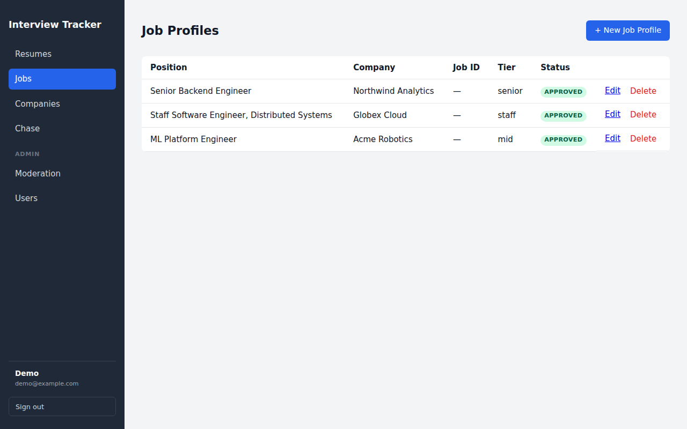
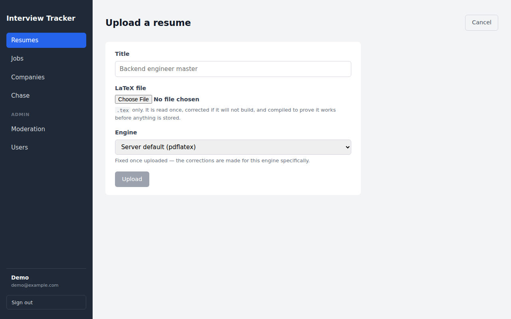
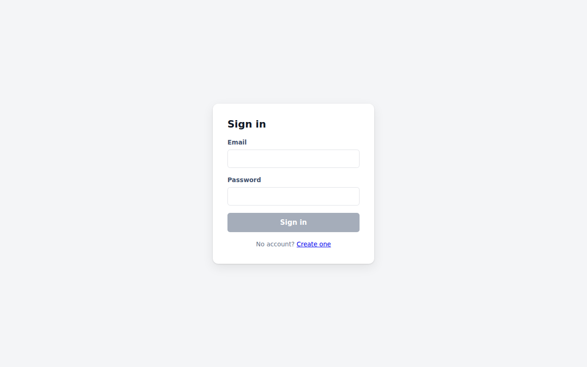

# Chase — AI resume tailoring & job matching

[](https://github.com/thakurabhishek7283/chase/actions/workflows/ci.yml)
[](https://github.com/thakurabhishek7283/chase/actions/workflows/release.yml)
[](LICENSE)

An Angular + FastAPI system that semantically matches job openings to your
career goals, and uses Gemini to score your LaTeX resume against an ATS and
tailor it: repeatedly, one reviewed change at a time, without the template
ever moving.



> The services, database and containers still carry the project's earlier
> codename, `jarvis` (for example the `jarvis` Compose project, the `jarvis`
> database, `JARVIS_TEST_DATABASE_URL`).

> 📖 **[ARCHITECTURE.md](ARCHITECTURE.md)** covers the system design, data
> model, request flows, deployment, and known gaps.

## Features

- **Template-preserving tailoring.** Your `.tex` master is split into frozen
  template bytes and editable content slots. AI rewrites touch only the slots,
  so every tailored version is visually identical to the master.
- **Reviewed, not auto-applied.** Each suggestion is a patch you accept,
  reject, or send back with feedback. Nothing renders until every patch is
  resolved.
- **ATS scoring.** A 0–100 match score with missing keywords, cached per
  version so you can check whether tailoring actually helped.
- **Semantic job matching.** Career goals and job descriptions are embedded
  on your machine (fastembed/ONNX, no API key) and ranked with pgvector.
- **Real PDFs.** pdfLaTeX, XeLaTeX, LuaLaTeX and latexmk run in an isolated,
  unprivileged worker container with shell escape disabled.
- **Multi-user.** Argon2 passwords, rotating refresh tokens, per-owner data
  isolation, and an admin-moderated shared company/job catalogue.

## Quick start (Docker)

The only requirement is [Docker](https://docs.docker.com/get-docker/) with
the Compose plugin. It works on Linux, macOS (Intel and Apple Silicon) and
Windows.

```bash
git clone https://github.com/thakurabhishek7283/chase.git
cd chase
docker compose up -d --build        # or: make up
```

Open **http://localhost:8080**. API docs are at http://localhost:8080/docs.

The first build compiles a curated TeX Live install and takes roughly 15–20
minutes; later builds are cached. To skip it, use the
[published images](#using-the-published-images) instead.

### 1. Add your Gemini key

The app starts without any configuration, but upload, review and tailoring
need an LLM. Get a free key from
[Google AI Studio](https://aistudio.google.com/apikey), then:

```bash
cp backend/.env.example backend/.env    # Windows: copy backend\.env.example backend\.env
# edit backend/.env and set GOOGLE_API_KEY=...
docker compose up -d                    # recreates the backend with the new settings
```

Until a key is set, those routes answer `503` naming the variable to set.

### 2. Become the admin

The admin clears the moderation queue for shared companies and jobs. Do
either of these:

- set `BOOTSTRAP_ADMIN_EMAIL` in `backend/.env` **before** registering with
  that address, or
- register normally, then promote the account:
  ```bash
  docker compose exec backend python -m app.cli promote-admin you@example.com
  # or: make admin EMAIL=you@example.com
  ```

### Using the published images

Every push to `main` publishes multi-arch (amd64 + arm64) images to GitHub
Container Registry. Pulling them skips every local build:

```bash
docker compose pull && docker compose up -d   # or: make pull
```

Pin a release with `JARVIS_VERSION=0.1.0` in a root `.env` (see
[`.env.example`](.env.example)).

### Day-to-day

| Task | Command | `make` |
|---|---|---|
| Start / rebuild | `docker compose up -d --build` | `make up` |
| Status and health | `docker compose ps` | `make ps` |
| Logs | `docker compose logs -f backend` | `make logs` |
| Stop (keeps data) | `docker compose down` | `make down` |
| Stop and **delete all data** | `docker compose down -v` | |
| Admin CLI | `docker compose exec backend python -m app.cli --help` | |

## How it fits together

```
 browser ──► :8080  frontend (nginx) ──/api, /docs──► backend (FastAPI)
                    serves the Angular build               │
                                       ┌───────────────────┼─────────────────┐
                                       ▼                   ▼                 ▼
                              postgres + pgvector   latex-worker       Gemini API
                                 (internal)          (internal)        (external)
```

Only the frontend publishes a port. nginx serves the UI and proxies the API
on the same origin, so there's no CORS setup and one build works on any
hostname. Postgres, the API and the LaTeX worker are reachable only on the
Compose network.

| Directory | What | Stack |
|---|---|---|
| [`backend/`](backend) | REST API, auth, AI agents, LaTeX parsing/splicing | FastAPI, SQLModel, Alembic, Pydantic AI, [uv](https://docs.astral.sh/uv/) |
| [`frontend/`](frontend) | Single-page app | Angular (standalone components, signals) |
| [`latex-worker/`](latex-worker) | Sandboxed PDF compilation over HTTP | TeX Live, stdlib Python |
| `docker-compose*.yml` | Production-like stack, plus a dev overlay | Docker Compose |

## Configuration

App settings live in `backend/.env`. Every variable is annotated in
[`backend/.env.example`](backend/.env.example) and described in
[ARCHITECTURE.md §12](ARCHITECTURE.md#12-configuration-reference). The ones
worth knowing:

| Variable | Default | Notes |
|---|---|---|
| `GOOGLE_API_KEY` | – | **Required for AI features.** The free tier is 5 req/min and 20/day |
| `ATS_MODEL` | `gemini-3.5-flash` | Any Gemini model id |
| `BOOTSTRAP_ADMIN_EMAIL` | – | Registering with this address grants admin |
| `JWT_SECRET_KEY` | generated | In Docker, generated once and kept in the `backend-data` volume. Set it explicitly when running several instances |
| `LOG_LEVEL` | `INFO` | Level for the `app.*` loggers |

Compose-level values (`APP_PORT`, Postgres credentials, image tag) go in a
root `.env`; see [`.env.example`](.env.example).

## Development

For reload-on-save, run the backend and frontend natively and keep Postgres
plus the LaTeX worker in containers. You'll need Python 3.12 with
[uv](https://docs.astral.sh/uv/), and Node.js 24 (or ≥ 22.22).

```bash
# Postgres on 127.0.0.1:5432 and the LaTeX worker on :8100,
# plus the jarvis_test database the test suite uses
make dev-infra
#   = docker compose -f docker-compose.yml -f docker-compose.dev.yml up -d postgres latex-worker

# Backend: http://localhost:8000/docs
cd backend
uv sync --extra local-embeddings
cp .env.example .env            # set GOOGLE_API_KEY, BOOTSTRAP_ADMIN_EMAIL
uv run alembic upgrade head
uv run uvicorn app.main:app --reload

# Frontend: http://localhost:4200 (proxies /api to :8000)
cd frontend
npm ci
npm start
```

Or run the backend in a container with hot reload:
`docker compose -f docker-compose.yml -f docker-compose.dev.yml up --build`.

### Quality checks

CI runs all of these on every push and pull request.

| Check | Command |
|---|---|
| Backend lint and format | `cd backend && uv run ruff check . && uv run ruff format --check .` |
| Backend tests (needs `make dev-infra`) | `cd backend && uv run pytest` |
| Frontend format | `cd frontend && npm run format:check` |
| Frontend tests | `cd frontend && npm run test:ci` |
| Frontend production build | `cd frontend && npm run build` |
| Everything | `make check` |

Backend tests run against real Postgres and a real LaTeX compile. Only the
LLM is scripted. Optional git hooks: `pip install pre-commit && pre-commit install`.

## Deploying beyond your laptop

The Compose stack is production-shaped: non-root containers, health checks,
restart policies, and nothing but the web port exposed. Before putting it on
a public host:

- Put TLS in front, e.g. Caddy, Traefik, or a cloud load balancer forwarding
  to `APP_PORT`.
- Set a strong `POSTGRES_PASSWORD` in the root `.env` and an explicit
  `JWT_SECRET_KEY` in `backend/.env`.
- Back up the `pgdata` volume. It holds every account and resume.
- Keep a single backend worker (the default). The sign-in rate limiter is in
  memory, so N workers allow roughly N× the attempts. See
  [ARCHITECTURE.md §16](ARCHITECTURE.md#16-deployment--operations) for
  scaling notes.

## Troubleshooting

| Symptom | Fix |
|---|---|
| `503 … needs a Gemini API key` | Set `GOOGLE_API_KEY` in `backend/.env`, then `docker compose up -d` |
| Uploads fail / "No LaTeX worker reachable" | `docker compose ps` should show `latex-worker` as healthy. Check `docker compose logs latex-worker` |
| An upload 422s on a missing package | Add its collection to the `tlmgr install` line in `latex-worker/Dockerfile` and rebuild |
| "port is already allocated" on 8080 | Set `APP_PORT=8081` (or any free port) in a root `.env` |
| No **Moderation** link in the sidebar | The account isn't an admin. See [Become the admin](#2-become-the-admin) |
| `/matching/*` returns 503 | The first match downloads the embedding model from huggingface.co, so the backend needs outbound internet once. Natively, use the `pgvector/pgvector` Postgres image, not plain `postgres` |
| Backend exits with `/bin/sh^M` or "no such file" | Windows checkout with CRLF line endings. Re-clone with Git ≥ 2.10; `.gitattributes` pins LF |
| Everything 401s after changing `JWT_SECRET_KEY` | Expected: existing sessions are signed with the old key. Sign in again |

## Status

| Phase | Scope | Status |
|---|---|---|
| 1 | Relational CRUD foundation | ✅ |
| 2 | Embedding engine + semantic matching | ✅ |
| 3–5 | ATS scoring, LaTeX masters, template-preserving tailoring, reviewed patches | ✅ |
| 6 | Authentication, owner-scoped data, moderated public data | ✅ |
| 7 | Cached ATS scores; tailored versions scored and re-reviewable | ✅ |

Pipeline/Kanban tracking was removed on purpose; a spreadsheet does that job
better. This project optimizes resumes, not application tracking. Known gaps
and next steps are listed in [ARCHITECTURE.md §14](ARCHITECTURE.md#14-known-gaps).

<p align="center">
  
  
</p>

## Licence

[MIT](LICENSE) © Abhishek Thakur
